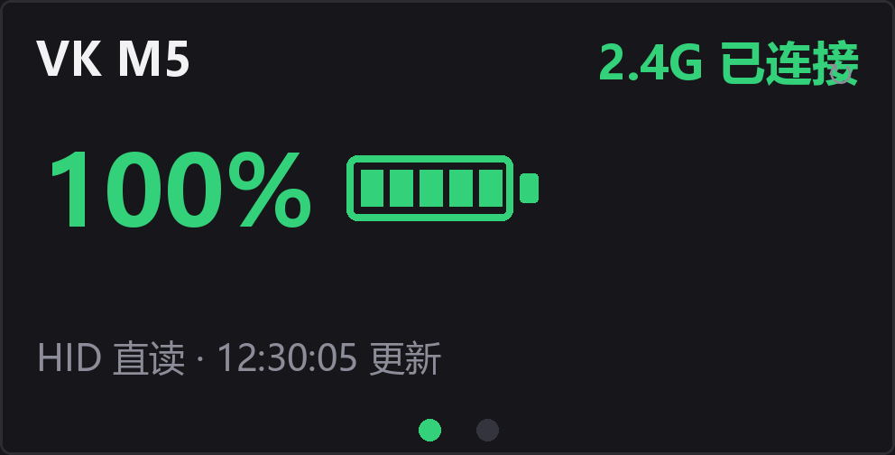
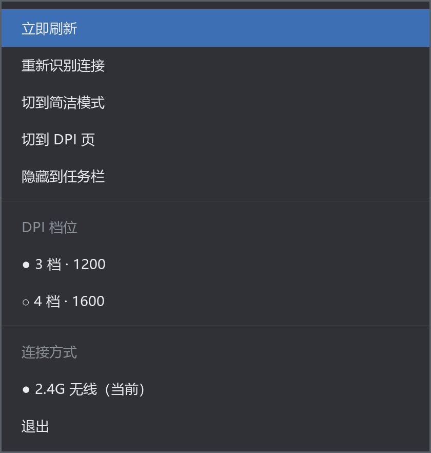

# VK M5 Monitor V24

Windows 下的 Valkyrie **VK M5** 三模电量 / DPI 监视器：2.4G、蓝牙、有线自动识别，托盘、浮窗、简洁圆盘三种界面同步显示。

内置 **A955**（VID `0x260D`）配置；其他鼠标可通过 `devices.json` 增加 VID/PID、电量字节偏移、蓝牙名等。

> 非官方工具，与 Valkyrie / 达尔优无关联。厂商协议来自公开 HID 报告与官方驱动行为分析，固件升级后可能失效。



## 功能

- **三模自动识别**：2.4G / 蓝牙 / 有线，按实际连接切换，不提供手动改连接方式。
- **2.4G 电量**：HID `F7` 特征报告，读设备当场回报的字节，约 5 秒刷新。
- **蓝牙电量**：优先 BLE HID `0x77` 查询（与 Valkyrie Driver 同一条命令），失败回退 GATT `0x180F/0x2A19`。
- **有线充电态**：显示「充电中」、闪电电池和 1.2 秒呼吸，不写死 100%。
- **DPI**：2.4G / 蓝牙 / 有线都支持读取与切换；蓝牙走 `0x55 + 0x90/0x10`。
- **立即刷新**：作废电量、DPI、链路缓存，马上重读。
- **界面**：完整浮窗、简洁圆盘、系统托盘图标、右键菜单。
- **本地配置**：`%APPDATA%\VK_M5\devices.json`，无遥测、无联网。


右键菜单：



30 秒介绍视频：[docs/intro.mp4](docs/intro.mp4)

## 下载

前往 **Releases** 下载 `VK_M5_v24.exe`（Windows 10/11，64 位，单文件，无需安装）。

- 文件大小：24,193,088 字节
- SHA256：`7A9F9C1FEB7E0240481B6980ABB31E3254AD03CF75E1AE0FD16FF8FB022024D0`

首次运行会在 `%APPDATA%\VK_M5\` 生成配置和状态文件；卸载时删除该目录即可。

## 从源码运行

要求 **Windows 10/11**、**Python 3.11**（`winsdk` 对 3.12 支持不完整）。

```powershell
python -m venv .venv
.\.venv\Scripts\Activate.ps1
pip install -r requirements.txt
python run_vk_m5.py
```

常用参数：

```powershell
python run_vk_m5.py --help
```

## 构建单文件 exe

```powershell
pip install -r requirements.txt
pyinstaller VK_M5_v24.spec --noconfirm
```

产物在 `dist/VK_M5_v24.exe`。`VK_M5_v24.spec` 只收集 `winsdk` 蓝牙判定所需的子包，避免把整个 winsdk 打进 exe。

## 目录结构

```
run_vk_m5.py          # 入口
VK_M5_v24.spec        # PyInstaller 打包脚本
vk.ico                # 图标
vk_m5/
  app.py              # 主界面 / 托盘 / 右键菜单 / 状态机
  reader.py           # 采集状态机：USB F7、BLE 0x77/GATT、DPI
  ble.py              # 蓝牙地址、GATT、BLE HID 0x77
  device.py           # HID 枚举与特征报告
  devices.py          # 设备配置（VK M5 / A955 / devices.json）
  a955.py             # A955 厂商协议
  tray.py             # 托盘图标
  simple.py           # 简洁圆盘
  menu.py             # 自绘右键菜单
  config.py           # 常量与调参
  ...
docs/                 # 截图与介绍视频
```

## devices.json

位置：`%APPDATA%\VK_M5\devices.json`。字段示例：

```json
{
  "devices": [
    {
      "name": "VK M5",
      "vid": "0x374A",
      "pid_wired": "0xA321",
      "pid_wireless": "0xA322",
      "pid_bt": "0xA323",
      "battery_offset": 2,
      "bt_name_match": "VK M5",
      "bt_addr": ""
    }
  ]
}
```

`bt_addr` 可填 12 位十六进制地址，留空则自动从 BLE 服务/注册表解析。修改后重启程序生效。

## 已知限制

- 仅 Windows；不支持 macOS / Linux。
- 蓝牙必须先由 Windows 完成配对，程序不会静默配对。
- 蓝牙 DPI 写入依赖厂商协议，单次约 0.5–1 秒；若 Valkyrie Driver 同时占用 HID，可能失败。
- 蓝牙电量优先 `0x77`；若设备不响应则回退 GATT，GATT 可能是系统缓存值，界面会标注「蓝牙缓存」。
- 2.4G 电量依赖 `F7` 报告；鼠标休眠/不动时沿用上次读数，最长 30 分钟。
- 非官方协议，固件更新可能导致读数或 DPI 失效。

## 免责声明

本项目按“现状”提供，不提供任何明示或暗示担保。使用第三方 HID 命令存在风险，请自行评估；因使用本工具造成的设备异常、数据丢失等，作者不承担责任。

## License

MIT。详见 [LICENSE](LICENSE)。
